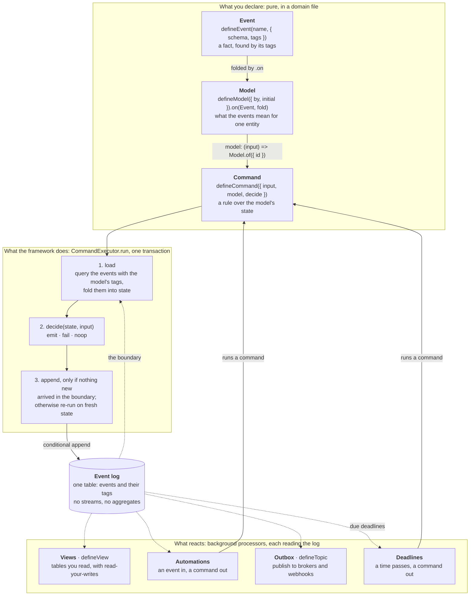
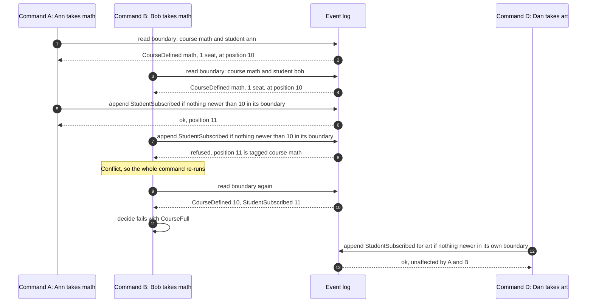

# ts-effect-crablet


[](https://codecov.io/gh/rodolfodpk/ts-effect-crablet)


Event sourcing for TypeScript with **Dynamic Consistency Boundaries** (DCB), built on [Effect](https://effect.website) and PostgreSQL.

## The problem

Some business rules span more than one thing. A course holds at most 30 students, *and* a student takes at most 3 courses. With aggregates, one of
the two has to own "subscribe", and the other rule is patched with a saga, a process manager or a lock taken by hand.

Here there are no aggregates and no streams. Events go into one log, tagged with what they are about. A command declares the events its decision
depends on, and its append succeeds only if none of them changed since it read them. So both rules are checked in one atomic decision, and two
commands conflict only when one changes something the other relied on. This is an implementation of the open [DCB specification](https://dcb.events/specification/) ([how compatible, requirement by requirement](./docs/concepts/dcb-guide.md#compatibility-with-the-specification)); all ten of its
[examples](./docs/concepts/dcb-examples.md) are written here, each raced on Postgres.

> **Status: experimental, pre-release.** The API changes often, there is no stability promise yet, and the packages are not on npm. To try it today, clone this repository
> and work in it. Not a fit if you are not on PostgreSQL or need a stable library now. What would make it ready, and what is still open: the
> [roadmap](./ROADMAP.md#before-a-10). (The policy for changing the API is [ADR-0013](./docs/adr/0013-api-evolution-additive-vs-breaking.md), an *architecture decision record*.)

## The mental model



You write three pure declarations. The **model** is the key one: the same `.on(...)` handlers give `decide` its state and give the command its
**consistency boundary**, the events whose arrival would change the answer. The executor loads that boundary, calls `decide`, and appends only if
nothing new arrived in it, so commands with different boundaries never wait for each other. Everything downstream reads the same log. More diagrams: [architecture](./docs/concepts/architecture.md).

## Both rules, one command

<!-- file: examples/quickstart/src/quickstart.ts#readme -->
```ts
// 1. Events: a name, a payload, and the tags an event can be found by. One fact can be found through two things.
export const CourseDefined = defineEvent("CourseDefined", {
  schema: Schema.Struct({ courseId: Schema.String, capacity: Schema.Int }),
  tags: (d) => ({ course_id: d.courseId })
});
export const StudentSubscribed = defineEvent("StudentSubscribed", {
  schema: Schema.Struct({ studentId: Schema.String, courseId: Schema.String }),
  tags: (d) => ({ student_id: d.studentId, course_id: d.courseId })
});

// 2. Models: what the events mean for one course, and for one student. Each also says which events
//    could change that answer, and that is the consistency boundary.
export const CourseModel = defineModel({ by: "course_id", initial: () => ({ exists: false, capacity: 0, subscribers: 0 }) })
  .on(CourseDefined, (c, d) => ({ ...c, exists: true, capacity: d.capacity }))
  .on(StudentSubscribed, (c) => ({ ...c, subscribers: c.subscribers + 1 }));
export const StudentModel = defineModel({ by: "student_id", initial: () => ({ courses: [] as ReadonlyArray<string> }) })
  .on(StudentSubscribed, (s, d) => ({ courses: [...s.courses, d.courseId] }));

export class CourseNotFound extends DomainError("CourseNotFound", { fields: { courseId: Schema.String }, kind: "not_found" }) {}
export class CourseFull extends DomainError("CourseFull", { fields: { courseId: Schema.String }, kind: "conflict" }) {}
export class StudentAtLimit extends DomainError("StudentAtLimit", { fields: { studentId: Schema.String }, kind: "conflict" }) {}

// 3. A command: a pure decision over BOTH models. Nothing here touches a database.
export const Subscribe = defineCommand({
  name: "subscribe",
  errors: [CourseNotFound, CourseFull, StudentAtLimit], // checked against `decide`, and documented by the REST API
  input: Schema.Struct({ studentId: Schema.String, courseId: Schema.String }),
  model: (c) => all({ course: CourseModel.of({ id: c.courseId }), student: StudentModel.of({ id: c.studentId }) }),
  idempotentBy: byModel(), // the model shows whether it was done; decide answers a repeat
  decide: ({ course, student }, c) =>
    !course.exists
      ? fail(new CourseNotFound({ courseId: c.courseId }))
      : student.courses.includes(c.courseId)
        ? noop("ALREADY_SUBSCRIBED")
        : course.subscribers >= course.capacity
          ? fail(new CourseFull({ courseId: c.courseId }))
          : student.courses.length >= 3
            ? fail(new StudentAtLimit({ studentId: c.studentId }))
            : emit(StudentSubscribed(c))
});
```

The boundary of `Subscribe` is the course's events plus the student's events. It comes from the two models; you never write that query.

**Run it, no database needed** ([`examples/quickstart`](./examples/quickstart/README.md)). You need Bun 1.4 or newer, and Node 24 or newer (it runs the `.ts` file directly). It starts from a history where `math` has one seat:

```bash
bun install
node examples/quickstart/src/quickstart.ts
```

```
ann -> math  created: StudentSubscribed
bob -> math  failed: CourseFull
ann -> math  idempotent: nothing appended
ann -> art   created: StudentSubscribed
ann -> bio   created: StudentSubscribed
ann -> chem  failed: StudentAtLimit
cy -> ghost  failed: CourseNotFound
```

**What a run in memory cannot show is two commands at once.** On Postgres, when two students ask for the last seat at the same moment, exactly
one is subscribed. The other's append is refused, because the first subscription is in its boundary; its command re-runs on fresh state and fails
with `CourseFull`. Subscriptions to other courses never wait. A test forces that overlap with a barrier
([`enrolment-guide-postgres.test.ts`](./packages/commands/test/integration/enrolment-guide-postgres.test.ts)), and
[tutorial step 2](./docs/tutorial/02-postgres-and-the-second-rule.md) lets you run it yourself.



**On Postgres** it is one layer. This is an excerpt: the database and its migrations are set up in [tutorial step 2](./docs/tutorial/02-postgres-and-the-second-rule.md).

<!-- excerpt -->
```ts
const AppLive = Crablet.layer({ host: "localhost", port: 5432, database: "app", username: "app", password: Redacted.make("secret") });
const program = Effect.gen(function* () {
  const executor = yield* CommandExecutor;
  yield* executor.run(Subscribe, { studentId: "ann", courseId: "math" });  // validates, runs in a transaction, retries on conflict
});
Effect.runPromise(Effect.provide(program, AppLive));
```

## What you get

*Words you may not know yet: a **view** is a read model kept up to date from the events; an **automation** reacts to an event by issuing a command; the **outbox** publishes events to other systems; a **leader** is the one process that runs a background part of the application; a **marker** says where in the log a write ended; a **tag** is a label on an event saying what it is about. The [glossary](./docs/reference/glossary.md) has all of them.*

- **One rule across several things, without a saga.** A course limit and a student limit, or a transfer between two accounts, is one command
  ([how it works](./docs/concepts/dcb-guide.md)).
- **Unrelated commands never wait for each other.** Two subscriptions conflict only if they share a course or a student.
- **Decisions you can test without a database.** Given/When/Then tests run the real pipeline on an in-memory store that passes the same
  conformance suite as the Postgres one.
- **Types from the domain to the HTTP API.** A command lists the errors it can fail with, the compiler checks `decide` against that list, and the REST
  API and its OpenAPI description are generated from it.
- **After a write, your next read sees it.** A command returns a *marker*. A read that carries it waits until the views include that write, or
  answers `503`. It never returns stale data.
- **Things that happen because time passed.** A decision can set a *deadline*, a command to run at a given time (an unpaid seat given back
  after three days), stored as an event with the decision. A deadline that repeats, a monthly fee, is a command that sets the next one
  ([set a deadline](./docs/guides/build/set-a-deadline.md)).
- **Built to be run.** If a node dies, another takes over within seconds, and two nodes never handle the same events as leader at once. No event is
  skipped, and changes to stored events are checked before a deploy. Each of these is tested and measured
  ([guarantees and evidence](./docs/evidence.md)).

How the pieces fit (views, automations, the outbox, deadlines, leadership), in diagrams: [Architecture](./docs/concepts/architecture.md).

## Where next

| You want to | Read |
|---|---|
| Try it | [The quick start](./examples/quickstart/README.md): one command, no database |
| Learn it | [The tutorial](./docs/tutorial/README.md): in memory, Postgres, HTTP and OpenAPI, reading your own writes, a web page |
| Decide if it fits | [Why not something else?](./docs/concepts/why-not.md), [questions adopters ask](./docs/concepts/faq.md), [guarantees and evidence](./docs/evidence.md), [the dcb.events examples](./docs/concepts/dcb-examples.md) |
| Understand it | [Consistency boundaries](./docs/concepts/dcb-guide.md) and the [architecture](./docs/concepts/architecture.md) |
| Use only the event store, without commands (a script, an import, an export) | [Use the event store directly](./docs/guides/build/use-the-event-store-directly.md): read, decide and append with the specification's condition |
| Find anything else | [The documentation map](./docs/README.md): guides for building and operating, the reference, the decisions |

Build and test: `bun install`, `bun run typecheck`, `bun run test:unit`, `bun run test:integration` (Docker). Details in the [reference](./docs/reference/README.md#build--test).
