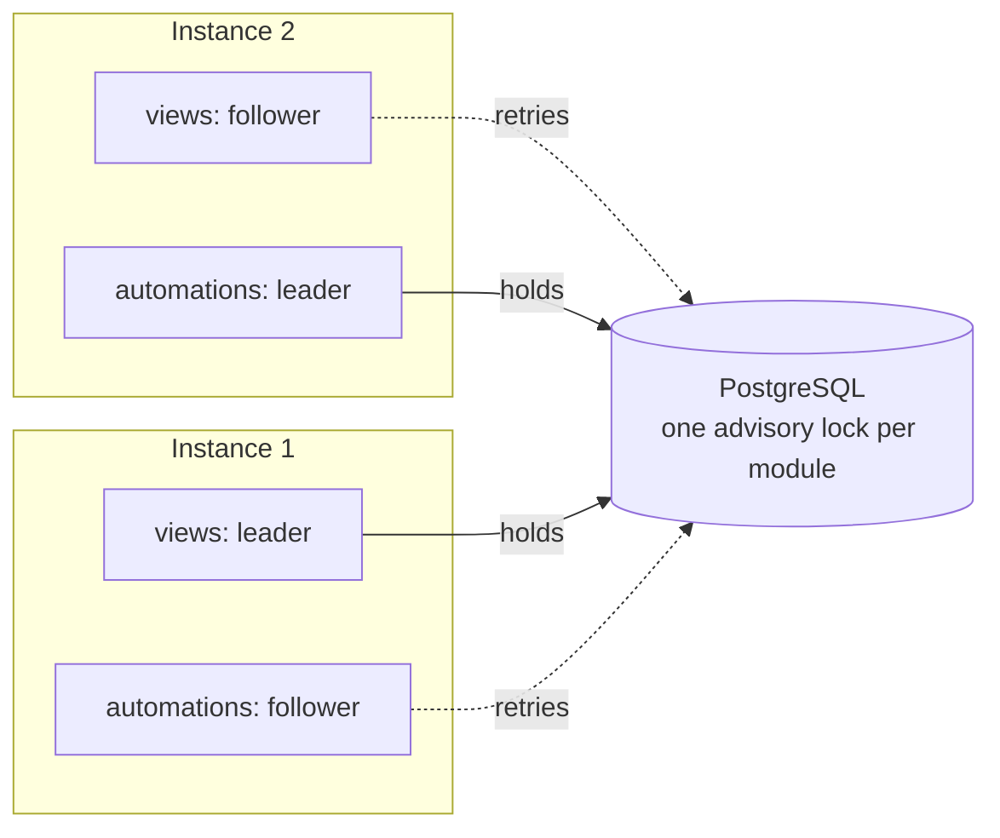

# Background processors: leaders, fences and roles

*Concept · developers and operators running more than one instance · [views and delivery](./views-and-delivery.md) · 10 minutes*

Views, automations, outbox publishers and the deadlines processor run in the background. You can run several instances of an application, and every instance answers commands
and reads. The background work, though, must run in one place at a time, or two instances would apply the same batch. This page is how that is
arranged, and what happens when an instance dies.

## One leader per module

The background work is grouped in four **modules**: the views, the automations, the outbox and the deadlines. Each module has one PostgreSQL
advisory lock. The instance that holds it is the module's **leader** and runs all of that module's processors; the others are followers and retry the
lock on an interval (5 seconds by default). The modules can have different leaders. An application starts only the modules it uses: the wallet has
no deadlines, the course app has no outbox. The deadlines module fires each deadline whose time has passed: it reads a table by due time instead of
following the log ([a deadline, from setting it to firing it](./architecture.md#a-deadline-from-setting-it-to-firing-it)).

## When a leader goes away

| What happens | What follows |
|---|---|
| The leader stops gracefully | It releases the lock and wakes the followers; one takes over at once. |
| The leader's process dies | Its database session ends and the lock with it. A follower takes over at its next retry, within the retry interval. |
| The leader loses its database session but keeps running | A heartbeat asks Postgres whether *this* session still holds the lock. Before every batch, and before every cursor move, a **fence** checks the same thing, so the stale leader stops at its next check. A check is not a lock: a batch already past it can still be handled once more, by the stale leader and its successor both. What makes that safe is the cursor, which moves only from where the batch started ([ADR-0032](../adr/0032-the-cursor-moves-only-from-where-its-batch-started.md)): a view's repeated batch is rolled back, an automation's repeated command appends nothing, and an outbox publication is at least once ([views and delivery](./views-and-delivery.md)). |

The cursor can only move forward, so a stale leader that slipped past the fence still cannot rewind another leader's progress, and a view's batch
commits with its cursor, so a batch handled twice is applied once ([views and delivery](./views-and-delivery.md)).

Why the heartbeat asks about the lock and not just "does the connection answer": a pooled connection can come back on a new session that answers queries
but holds no lock. The [reliability report](../history/plans/reliability-and-scale-diagnostic.md) records how this was found and measured.

## Roles: one process or several deployments

The same application image can run everything in one process, or be split into deployments by role: `api` (commands, reads, the live feed),
`views`, `automations` (which runs the deadlines too: both fire commands through the same executor) and `outbox`. Roles talk to each other only through Postgres, so splitting changes nothing in the code. A worker role with more
than one replica gives a warm standby, because the module lock still decides who works ([ADR-0022](../adr/0022-runtime-roles.md), accepted; the wallet
runs it, and the kind lab ran its failure scenarios).

## Behind a connection pooler

The leader lock and the `LISTEN` that wakes the pollers need a real database session, which a pooler in transaction mode (PgBouncer, RDS Proxy) does
not give. An application can give those few connections a direct endpoint and send everything else through the pooler
([ADR-0024](../adr/0024-session-connections-for-leader-and-listen.md), [behind a pooler](../guides/operate/run-in-production.md#behind-a-pooler-pgbouncer-rds-proxy)).

## See it break

The [kind lab](../guides/operate/run-the-kind-lab.md) runs the wallet as separate deployments on a local Kubernetes cluster, and lets you kill a leader,
cut the network or run out of connections while watching who takes over.

## Decisions behind this page

[ADR-0006](../adr/0006-leader-election-via-sql-reserve.md) (leader election) · [ADR-0007](../adr/0007-event-poller-fiber-model.md) (the poller's fibers) ·
[ADR-0021](../adr/0021-wakeups-after-commit-and-coalesced.md) (wake-ups) · [ADR-0022](../adr/0022-runtime-roles.md) (roles) ·
[ADR-0024](../adr/0024-session-connections-for-leader-and-listen.md) (session connections)
