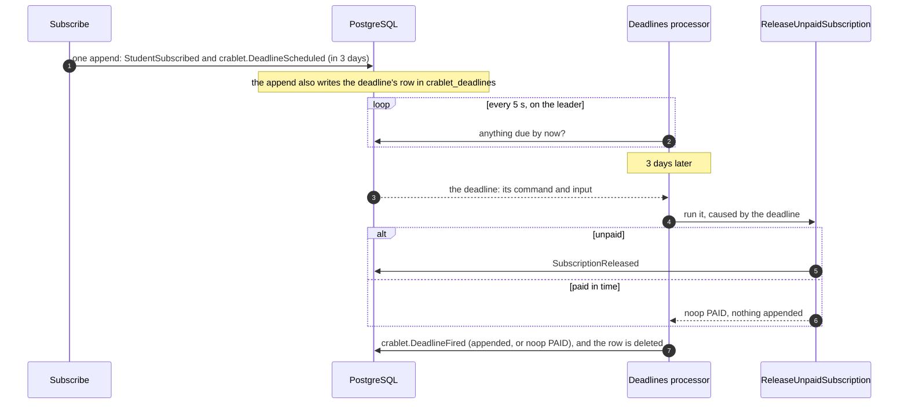
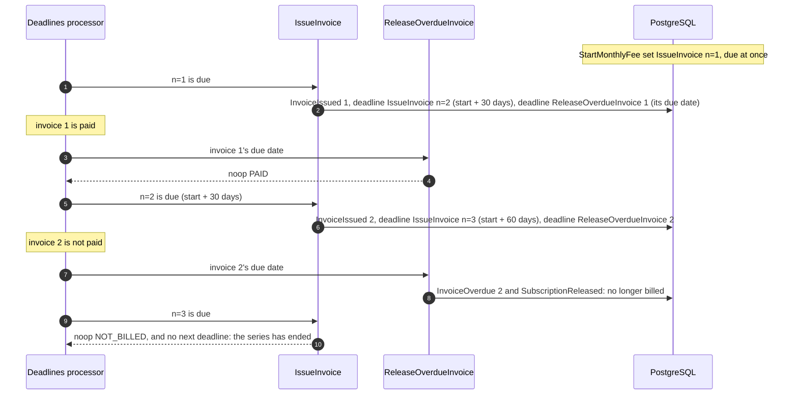

# Set a deadline

*Guide · developers · [Add an automation](add-an-automation.md) done · 10 minutes*

Some things should happen because **time passed**, not because something else happened: a seat held for 15 minutes is given back, a subscription
left unpaid for three days is released, enrolment closes on Friday. A command can set a **deadline** for that: another command to run once a time has
passed. The deadline is an event in the log, appended with the decision that sets it, and the deadlines processor runs its command when it is due. The
example is the course app's payment window.



[← Task guides](../README.md)

## 1. Set it with the decision

`deadline(Command, input, { at })` (`@crablet/commands/Domain`) is returned by `decide` with the rest of its events. The input is typed by the command's
schema, and `at` is a `DateTime.Utc`, usually computed from `now`:

<!-- file: examples/course-enrolment-app/src/domain/Enrolment.ts#subscribe -->
```ts
export const Subscribe = defineCommand({
  ...SubscribeContract,
  // The boundary is the union of the course's events and the student's events.
  model: (c) => all({ course: CourseModel.of({ id: c.courseId }), student: StudentModel.of({ id: c.studentId }) }),
  idempotentBy: byModel(), // the model shows whether it was done; decide answers a repeat
  decide: ({ course, student }, c, { now }) =>
    !course.exists
      ? fail(new CourseNotFound({ courseId: c.courseId }))
      : course.cancelled
        ? fail(new CourseWasCancelled({ courseId: c.courseId }))
        : student.courses.includes(c.courseId)
          ? noop("ALREADY_SUBSCRIBED")
          : course.subscribers >= course.capacity
            ? fail(new CourseFull({ courseId: c.courseId, capacity: course.capacity }))
            : student.courses.length >= MAX_COURSES_PER_STUDENT
              ? fail(new StudentAtLimit({ studentId: c.studentId, limit: MAX_COURSES_PER_STUDENT }))
              : emit(
                  StudentSubscribed({ ...c, subscribedAt: now }),
                  // When the payment window closes, the deadlines processor asks for the seat back; a paid subscription answers that it is paid.
                  deadline(ReleaseUnpaidSubscription, { courseId: c.courseId, studentId: c.studentId }, { at: DateTime.add(now, { days: PAYMENT_WINDOW_DAYS }) })
                )
});
```

It is part of the append, so a deadline exists exactly when the decision that set it does: a refused or repeated subscription sets none.

## 2. The command decides whether it still matters

A deadline always fires; there is no cancel. Its command reads the model, like any command, and answers `noop` when the deadline no longer matters. The
model already knows (the subscription was paid), and a cancel would be a second place to keep that consistent:

<!-- file: examples/course-enrolment-app/src/domain/Payments.ts#release -->
```ts
// Gives back a subscription that was not paid once its window has closed. Its boundary is the subscription's events, so a payment and a release that
// race cannot both happen: the second conflicts, re-runs, and sees the first. The deadline `Subscribe` sets runs it at the window's end; for a paid
// subscription it answers PAID, and that is all a deadline that no longer matters costs (there is no cancel). One billed monthly is not released here:
// an overdue invoice releases it (src/features/monthly-fee).
export const ReleaseUnpaidSubscription = defineCommand({
  name: "release_unpaid_subscription",
  input: Schema.Struct({ courseId: Schema.String, studentId: Schema.String }),
  model: (c) => SubscriptionModel.of({ id: c.studentId, courseId: c.courseId }),
  idempotentBy: byModel(),
  decide: (s, c, { now }) =>
    s.status === "none"
      ? noop("NOT_SUBSCRIBED")
      : s.status === "released"
        ? noop("ALREADY_RELEASED")
        : s.status === "paid"
          ? noop("PAID")
          : s.status === "billed"
            ? noop("BILLED_MONTHLY")
            : s.windowClosesAt !== null && !windowClosed(s, now)
              ? noop("WINDOW_OPEN")
              : emit(SubscriptionReleased(c))
});
```

The command must declare `idempotentBy`: a deadline can fire twice (a crash between the command and the record of its firing), and the repeat must be
"already done". Its input must have no `personal(...)` field: it is stored inside a framework event, where it cannot be masked or erased, so give it
ids. `deadline(...)` refuses either at once, so the first test of the command that sets it fails.

## 3. Run the deadlines processor

Start it with the commands deadlines may name, owned by a Scope like the other processors:

<!-- file: examples/course-enrolment-app/src/CourseApp.ts#deadlines -->
```ts
// Starts the deadlines processor (ADR-0043), owned by the Scope like the views: when a subscription's payment window closes it runs the release
// Subscribe set, when a course's readiness period ends the cancellation DefineCourse set, and the monthly fee's invoices and their due dates (the
// feature lists its own). One instance fires, the others wait on its lock.
export const startCourseDeadlines = (
  instanceId: string = defaultInstanceId()
): Effect.Effect<ProcessorHandle, never, SqlClient.SqlClient | CommandExecutor | EventStore | CommandAuditStore | Scope.Scope> =>
  startDeadlinesProcessor({ commands: [ReleaseUnpaidSubscription, CancelUnreadyCourse, ...monthlyFeeDeadlineCommands], instanceId });
```

`startDeadlinesProcessor` (`@crablet/automations/Deadlines`) polls `crablet_deadlines` for what is due by the application's clock, runs each command in
due order with the deadline as its cause, and records how it ended. It has a leader lock of its own, so one instance fires and the others wait; it belongs
with the automations role. `makeDeadlinesManagementService` gives the admin API its status, pause, resume and reset, and its backlog: how many deadlines are
due and how long ago the oldest fell due.

## 4. Test it without a database

`Scenario.fireDue(...commands)` does what the processor does, at the scenario's clock: it fires the deadlines due by then, in due order, and returns
how each ended.

<!-- file: examples/course-enrolment-app/test/payments.test.ts#deadline-test -->
```ts
test("subscribing sets the deadline; at the window's end an unpaid seat is released, and a paid one is left alone", async () => {
  const s = given(...math()).at(t0);
  const subscribed = await s.when(Subscribe, { studentId: "ann", courseId: "math" });
  expect(subscribed.events.map((e) => e.type)).toEqual(["StudentSubscribed", "crablet.DeadlineScheduled"]);
  await s.when(Subscribe, { studentId: "bob", courseId: "math" });
  await s.at(at(60_000)).when(PaySubscription, pay("bob", "p-1"));

  expect(await s.at(at(PAYMENT_WINDOW_MS - 1)).fireDue(ReleaseUnpaidSubscription)).toEqual([]); // not due yet
  const fired = await s.at(at(PAYMENT_WINDOW_MS)).fireDue(ReleaseUnpaidSubscription);
  expect(fired.map((f) => [f.outcome, f.reason, f.events.map((e) => e.type)])).toEqual([
    ["appended", null, ["SubscriptionReleased"]], // ann did not pay
    ["noop", "PAID", []] // bob did
  ]);
  expect(await s.at(at(2 * PAYMENT_WINDOW_MS)).fireDue(ReleaseUnpaidSubscription)).toEqual([]); // each fires once
});
```

## 5. A deadline that repeats

A deadline whose command sets the next one is a series: nothing else in the framework is needed. The course app's monthly fee
(`examples/course-enrolment-app/src/features/monthly-fee`) bills a subscription every 30 days instead of charging it once. Each run issues one invoice and
sets two deadlines, the next invoice and this invoice's due date:



<!-- file: examples/course-enrolment-app/src/features/monthly-fee/issue-invoice.ts#issue-invoice -->
```ts
// When the n-th invoice is issued: from the billing's start, never from when the deadline fired. A run that fires late (the processor was down, or
// behind) does not push the series: the next deadline is still at its planned date, and a series that fell behind catches up by itself, one invoice
// per poll, because each next deadline is already due.
const issueDateOf = (startsAt: DateTime.Utc, every: number, n: number): DateTime.Utc => DateTime.add(startsAt, { days: (n - 1) * every });

// When it falls due: INVOICE_DUE_DAYS after its planned date, but never sooner than INVOICE_DUE_DAYS from now. An invoice issued late still gives the
// student those days to pay; without it, the invoices of a series that caught up would be born overdue, and the seat released before the student
// ever saw them.
const dueDateOf = (issueDate: DateTime.Utc, now: DateTime.Utc): DateTime.Utc =>
  DateTime.max(DateTime.add(issueDate, { days: INVOICE_DUE_DAYS }), DateTime.add(now, { days: INVOICE_DUE_DAYS }));

// The deadline of the next run. A function with its type written, so the command can name itself: its own type is not needed to type its decide.
const next = (input: typeof IssueInvoiceInput.Type, at: DateTime.Utc): AppendEvent => deadline(IssueInvoice, input, { at });

// The model answers a repeat (the same deadline fired twice: a crash between running it and recording it, or a zombie leader): the billing knows the
// invoices it issued. A series ends without a cancel: once the subscription is no longer billed by it (an overdue invoice released it, the student
// stopped, the course was cancelled, or the student subscribed again), its pending deadline fires and answers NOT_BILLED, and sets no other.
export const IssueInvoice = defineCommand({
  name: "issue_invoice",
  input: IssueInvoiceInput,
  model: (c) => all({ billing: BillingModel.of({ id: c.billingId }), subscription: SubscriptionModel.of({ id: c.studentId, courseId: c.courseId }) }),
  idempotentBy: byModel(),
  decide: ({ billing, subscription }, c, { now }) => {
    if (!billedBy(subscription, c.billingId) || billing.startsAt === null) return noop("NOT_BILLED");
    if (billing.lastIssued >= c.n) return noop("ALREADY_ISSUED");
    const dueAt = dueDateOf(issueDateOf(billing.startsAt, billing.every, c.n), now);
    return emit(
      InvoiceIssued({ billingId: c.billingId, invoiceId: invoiceIdOf(c.billingId, c.n), n: c.n, amount: billing.amount, dueAt }),
      next({ ...c, n: c.n + 1 }, issueDateOf(billing.startsAt, billing.every, c.n + 1)),
      deadline(ReleaseOverdueInvoice, c, { at: dueAt })
    );
  }
});
```

- **Dates from the anchor.** Invoice *n* is issued at `startsAt + (n − 1) × 30 days`, never "the previous one plus 30": a late run does not push the
  series, and a series that fell behind (the processor was down) catches up by itself, one invoice per poll, because each next deadline is already due.
- **A floor under the due date.** An invoice issued late still gets its 10 days to be paid. Without it, the invoices of a series that caught up would be
  born overdue, and the seat released before the student saw them.
- **The series has an id from the client** (`billingId`, as a payment has its id). A student released, subscribed again and billed again starts a new
  series; the subscription remembers which one is current, so the old series' pending deadlines answer `NOT_BILLED`, and so do they after an overdue
  invoice, a stop, or a cancelled course. Nothing is cancelled.
- **Paying and releasing an invoice race over its events.** The payment reads only that invoice, so it does not conflict with issuing the next one; the
  release appends `InvoiceOverdue` tagged with the invoice, so a payment and a release that both read before either appended cannot both happen,
  whatever the pods' clocks say (`examples/course-enrolment-app/test/integration/monthly-fee.test.ts` forces that race on Postgres).
- **One file per slice.** The feature is its events (the contract between its slices), a file of shared models, and one file per command. Its events
  are tagged with the billing and the invoice, so the rest of the app's models never see them, except `BillingStarted`, which the subscription folds (a
  subscription is paid once or billed). The models that do not care about it are listed in the change-impact baseline with a reason, not edited.
  The feature lists its deadline commands (`monthlyFeeDeadlineCommands`) and the app spreads them into the processor's.

## What to know

- **What is in the log.** `crablet.DeadlineScheduled { command, input, dueAt }` with the decision, and `crablet.DeadlineFired { deadlinePosition,
  outcome, reason, marker }` caused by it, where `outcome` is `appended`, `noop` or `failed` (a domain error, with its tag). The command's events are caused by
  the deadline too, so a reader can see why the seat was released and for when it was set. Neither carries tags: no model of yours has to account for them.
- **Waiting for its effect.** The firing's `marker` is where the command's write ended (for a `noop`, the earlier write it pointed at; `null` for a
  failure): `waitUntilProcessed(view, parseMarker(marker))` waits until a view shows what the deadline did, as a client waits on a command's marker.
- **Precision.** A deadline fires at or after its time, by the clock of the instance that fires it: late by up to one polling interval (5 seconds by
  default), plus the deadlines due before it. It is for business time, not timers in seconds. One due while no instance ran fires once when one starts.
- **Moving one.** Set a new deadline and let the command tell which one is current: put the time it is for in its input and answer `noop` when the model
  says another is current.
- **Recurring work** is a chain of deadlines, each set by the run before it: section 5, and the acceptance test with a change of price and a calendar
  month (`packages/commands/test/deadline-recurring.test.ts`). With months, compute period *n* from the anchor (`DateTime.add(anchor, { months: n })`):
  Effect moves January 31 + 1 month to February 28, and a chain of "+1 month" stays on the 28th. Put the period number (and a version, if the schedule
  can change) in the input, so a repeat or a superseded deadline answers `noop`. A command that sets its own next deadline names
  itself; TypeScript cannot infer a type from its own initializer, so either annotate the command (`const Charge: Command<typeof input.Type, never,
  typeof input> = defineCommand(...)`) or, as the course app does, set the deadline from a function whose return type is written (`AppendEvent`).
- **A fault stops it.** A command that fails with something other than a domain error (the database, a conflict that ran out of retries), a command
  that takes longer than `fireTimeoutMs` (30 seconds by default), a command the processor was not given, or an input that no longer decodes: the batch is retried and, after `maxErrors`, the processor is `FAILED`, and the deadlines
  after it wait. Deadlines fire in due order, as a view's events are applied in order.
- **Stored data.** A deadline names its command, and its input is the command's input as it was. Renaming a command or changing its input schema must keep
  the deadlines already set readable: give `assertEventFixtures` the `deadlineCommands`, with a `crablet.DeadlineScheduled` fixture for each.

The design, and why the state stays in the log rather than in Effect's workflow engine: [ADR-0043](../../adr/0043-a-deadline-is-an-event-in-the-log.md).
